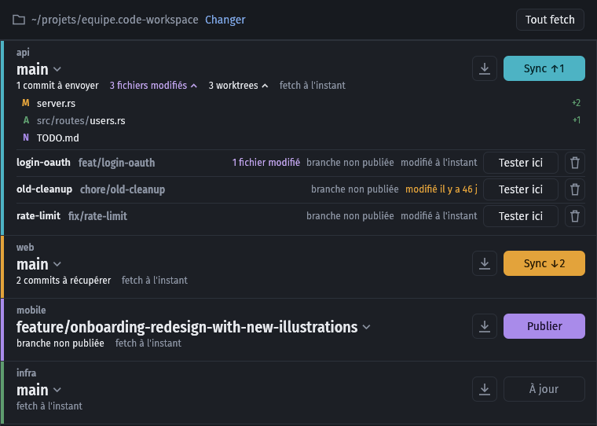

<p align="center">
  
</p>

<h1 align="center">Gang Branch 2000</h1>

<p align="center">
  L'outil git qui va avec votre agent de code : la branche, Fetch et Sync, les worktrees
  et les PR de vos dépôts, dans une petite fenêtre plutôt qu'un IDE.
</p>

<p align="center">
  
</p>

## Pourquoi

Avec un agent comme Claude Code, Gemini CLI ou Codex, le code s'écrit dans le terminal :
on décrit, l'agent écrit, on relit. L'IDE n'est plus l'endroit où l'on travaille, et
l'ouvrir rien que pour voir sur quelle branche on est, récupérer les derniers commits ou
pousser les siens, c'est sortir l'artillerie lourde pour trois clics.

Gang Branch 2000 est l'autre moitié de ce duo : un outil git très léger, qui s'ouvre en
une fraction de seconde et ne fait que ce qu'il reste à faire à la main. Voir où en est
chaque dépôt, changer de branche, Fetch et Sync. Et surtout suivre les worktrees que
créent les agents pour travailler en parallèle : leur état, leur PR, la possibilité d'en
tester un sur votre environnement local en un clic, puis de le supprimer une fois mergé.

Pas de commit, de staging ni de diff : c'est le travail de l'agent (ou le vôtre, dans le
terminal).

## Ce qu'il fait

- **Un dépôt par ligne**, avec un liseré de couleur qui donne l'état d'un coup d'œil :
  vert à jour, ambre en retard, cyan en avance, violet branche non publiée, rouge erreur.
- **La branche**, en grand, ouvre la liste des branches locales puis distantes (avec un
  filtre) ; choisir une branche distante crée la branche locale qui la suit.
- **Sync** porte les compteurs (« Sync ↓2 », « Sync ↑1 », « Publier ») et fait ce que fait
  VS Code : `git pull` puis `git push`, ou `git push -u origin <branche>` pour publier.
  **Fetch** fait un `git fetch --prune`.
- **Les fichiers modifiés** se déplient sous le dépôt, avec leur statut et le nombre de
  lignes ajoutées ou retirées ; un clic ouvre le fichier.
- **Les worktrees** aussi : leur branche, leur état, la date de leur dernière
  modification (en ambre au-delà de deux semaines) et l'état de leur PR.
  - « Tester ici » passe la branche du worktree dans le checkout principal, pour la
    tester là où tourne votre environnement local ; « Rendre » remet tout en place.
  - La corbeille supprime le worktree après confirmation, et sa branche si on le
    souhaite (proposé d'office quand la PR est mergée).
- **Les PR GitHub** de vos branches s'affichent (via `gh`), cliquables.
- **Le nom du dépôt** ouvre sa page GitHub.
- Un fetch à l'ouverture puis toutes les 5 minutes ; l'état se rafraîchit toutes les
  5 secondes. Thème clair ou sombre selon le système.

## Installation

Téléchargez le fichier de votre système dans les
[Releases](../../releases) (quand il y en a), ou construisez-le (voir plus bas).

| Système | Fichier | Remarque |
| --- | --- | --- |
| Linux | `gang-branch-2000-x86_64.AppImage` | rendez-le exécutable, lancez-le ; il s'ajoute au menu des applications |
| Windows | `gang-branch-2000-x86_64.exe` | un seul fichier, sans installation |
| macOS | `gang-branch-2000-macos.dmg` | app universelle, non notarisée : au premier lancement, clic droit › Ouvrir |

Il faut `git`, et [`gh`](https://cli.github.com/) connecté pour voir les PR.

## Utilisation

Au premier lancement, choisissez un dossier git, ou un fichier `.code-workspace` pour
suivre tous ses dossiers. Le choix est retenu (`~/.config/gang-branch-2000/config.json`) et
« Changer » en haut de la fenêtre en prend un autre.

```bash
gang-branch-2000-x86_64.AppImage --source ~/projets/mon-workspace.code-workspace
```

`--source` utilise ce dossier ou ce workspace sans toucher au choix enregistré.

## Construire

Rust stable (édition 2024).

```bash
cargo run                     # lancer en développement
cargo test                    # les tests (git doit être installé)

scripts/package.sh            # le paquet du système courant, dans dist/
scripts/package.sh linux      # AppImage (appimagetool et rsvg-convert requis)
scripts/package.sh windows    # .exe : sous Windows (Git Bash), ou depuis Linux avec
                              #   mingw-w64 et `rustup target add x86_64-pc-windows-gnu`
scripts/package.sh macos      # .dmg universel : sur un Mac uniquement
scripts/package.sh all        # tout ce que la machine sait construire
scripts/make-icons.sh         # régénère les icônes depuis assets/gang-branch-2000.svg
```

Le workflow GitHub `package` construit les trois paquets, chacun sur son système : en
lancement manuel, ou en poussant un tag `v*`, qui publie aussi une release.

Les choix de conception sont décrits (en anglais) dans [docs/design.md](docs/design.md).

## Crédits

La police [Fira Sans](https://github.com/mozilla/Fira) est sous licence SIL Open Font
License ([assets/fonts/OFL.txt](assets/fonts/OFL.txt)).
